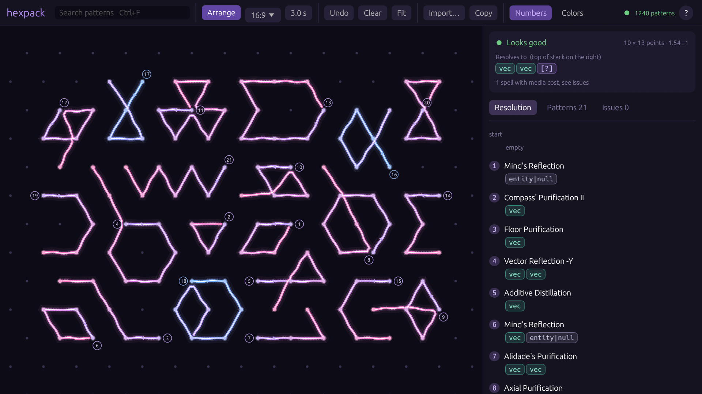

# hexpack

Draw [Hex Casting](https://modrinth.com/mod/hex-casting) patterns, see what your hex resolves to, and pack
all patterns tightly onto the grid so a long hex fits on one screen.



## Features

- **Drawing close to the original mod**: same hex grid, glowing lines, dots that light up near the cursor, and
  lines that bend around nodes they pass a second time.
- **Recognises** every pattern from Hex Casting and its addons, in any rotation, including numbers and
  Bookkeeper's Gambit masks.
- **Checks** the hex by simulating the stack step by step and pointing out mistakes.
- **Arranges** all patterns into the smallest 16:9 area (other ratios available).
- **Search** all patterns (Ctrl+F) and add them with a click.

## Quick start

**Windows:** download `hexpack-windows-x64.zip` from the
[latest release](https://github.com/Jesplay/Hexpack/releases/latest), extract it and run `hexpack.exe`.

**Linux / from source:** install [Rust](https://rustup.rs), then

```bash
git clone https://github.com/Jesplay/Hexpack.git
cd Hexpack
cargo run --release
```

## Obsidian (recommended, not required)

The pattern data lives in [`Hexwoven Vault/`](Hexwoven%20Vault), an [Obsidian](https://obsidian.md) vault.
hexpack only needs the folder next to it. If you have Obsidian, open the folder as a vault to browse every
pattern and book entry, and right-click a pattern in hexpack to jump to its page.

## Controls

| Input | Action |
| --- | --- |
| Left drag | draw (drag back to undo a stroke) |
| Right / middle drag | move the view |
| Mouse wheel | zoom |
| Right click | open in Obsidian, copy, delete |
| Delete / Ctrl+Z | delete selected / undo last |
| Ctrl+F | search |

Hexes can also be imported and copied as text, one pattern per line; see
[`examples/bridge.hex`](examples/bridge.hex).

## Building on Windows

`cargo build --release` works with the Visual Studio Build Tools installed. Without them, use the GNU toolchain:

```bash
rustup toolchain install stable-x86_64-pc-windows-gnu
cargo +stable-x86_64-pc-windows-gnu build --release
```

## Credits

Pattern data comes from the documentation of [Hex Casting](https://github.com/FallingColors/HexMod) and its
addons, collected in the Hexwoven Vault. hexpack is a fan project, not affiliated with their authors.

Code licensed under [MIT](LICENSE).
